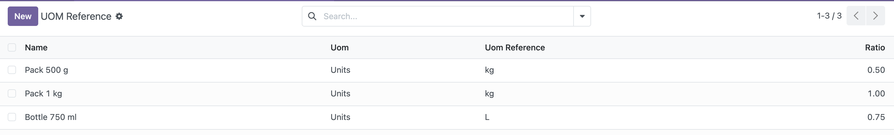
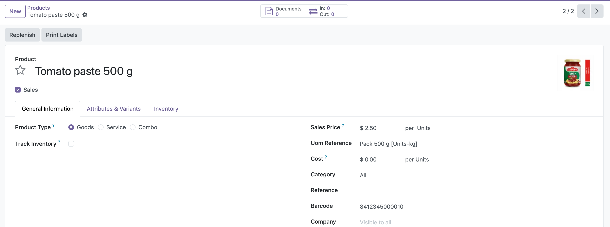
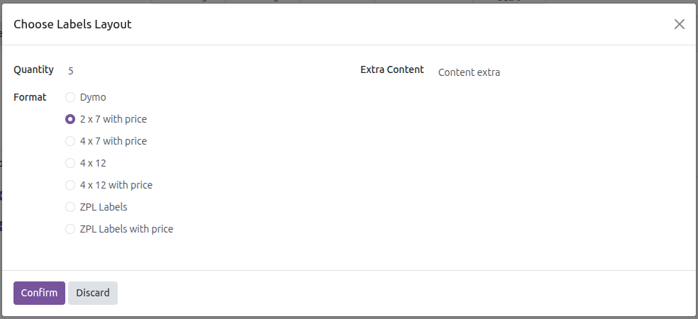
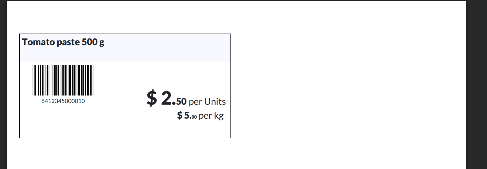
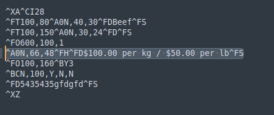

Add Uom Reference
----------------------------------------
1. Go to Inventory > Configuration > Product UOM Reference
2. Add a new item:
   * Name: a name to identify it, e.g. the packaging (Pack 500 g)
   * Uom: the unit of measure the product is sold in (Units)
   * Uom Reference: the unit of measure used for the unit price on the label (kg)
   * Ratio: quantity of the reference unit contained in one unit of the
     product (0.5 for a 500 g pack sold per Units and shown per kg)
3. Save

  

Configure Uom Reference in Product
-------------------------------------------
1. Go to Inventory > Products > Products
2. Create or edit a product
3. Select a Uom Reference. Only the references whose Uom matches the
   product's unit of measure are shown
4. Save

  

Print labels with Uom Reference
-------------------------------------
1. Follow the steps [Configure Uom Reference in Product](#configure-uom-reference-in-product)
2. Press the Print labels button and select the type of label you want to print
3. Press the button Confirm
4. Upon confirmation, the product label is generated, in which the price of the reference unit
   is shown below the product price: the product price divided by the ratio configured in
   [Add Uom Reference](#add-uom-reference).

   Example:
    * Product price: $2.50 per Units
    * Ratio: 0.5
    * Price per reference unit: $2.50 / 0.5 = $5.00 per kg

  

  

  
